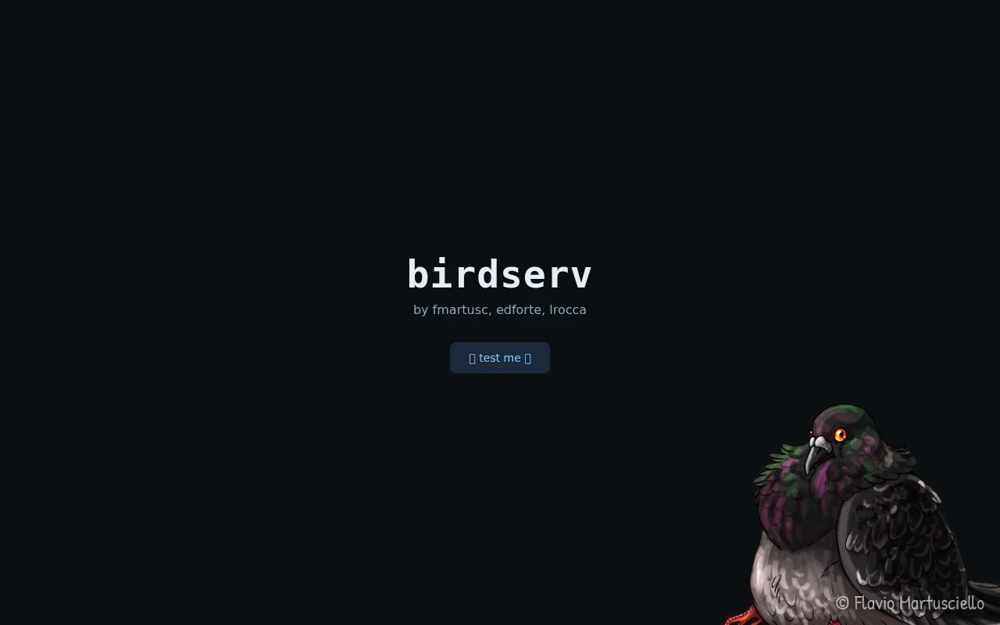
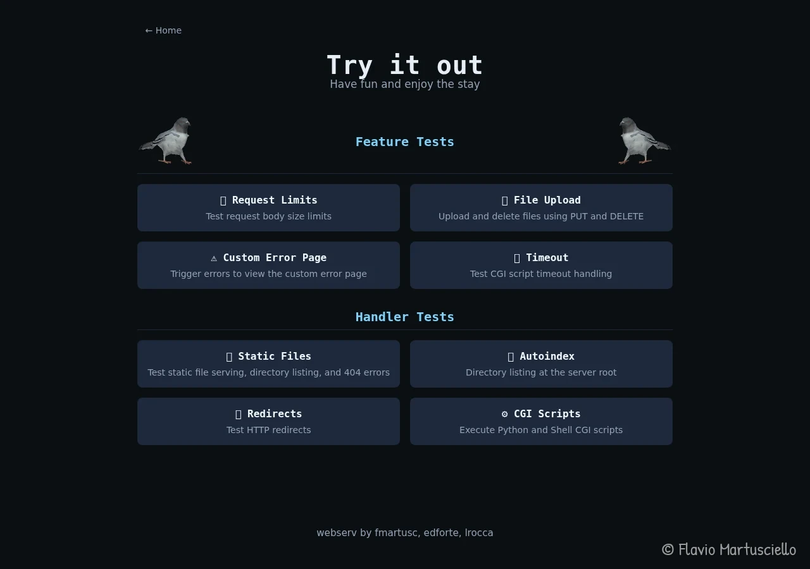

# birdserv

An HTTP server written from scratch in C++98, for the webserv project at 42 Roma Luiss. Team of three.



This is a copy of the team repository, kept on my profile as part of my portfolio. The full commit history is in the original repo: [cameriere-di-rete/webserv](https://github.com/cameriere-di-rete/webserv).

## The idea

A server spends its life carrying messages back and forth, like a homing pigeon. So birdserv got a pigeon as its mascot, and the test site grew around it: a dark, terminal-like style, simple cards for each test, the pigeon popping up in the corners. On the test page bread crumbs keep falling: they're the data the server hands out, and what pigeons go looking for. Session cookies become the crumbs you leave along the way, and every error page is a pun.

| | |
|---|---|
|  |  |

## What the server does

- many connections at the same time with `epoll`, non-blocking
- an nginx-like configuration file: ports, roots, locations, allowed methods, body size limits, redirects
- GET, POST and DELETE: static files, directory listing, uploads and deletions
- CGI scripts (Python, PHP, shell) with timeouts
- custom error pages for every status code

## My part

- the visual identity: the pigeon, the test site and all the error pages
- the upload page, with drag and drop and a progress bar, and the fix for large files and videos
- CGI timeouts, MIME types for media files, the test pages for redirects, timeouts and size limits

## Team

- fmartusc ([Fmartu](https://github.com/Fmartu))
- lrocca ([leeoocca](https://github.com/leeoocca))
- edforte ([edforte](https://github.com/edforte))

## Run it

```bash
make
./webserv conf/complete.conf
```

Then open http://localhost:8080. Without a file it uses `conf/default.conf`, and `-l:0` turns on debug logs (`./webserv -l:0 my.conf`).

The project also builds with CMake, which is what we used during development and for the tests:

```bash
cmake -S . -B build -DCMAKE_BUILD_TYPE=Release
cmake --build build -j
ctest --test-dir build --output-on-failure
```

The configuration options are described in [docs/CONFIGURATION.md](docs/CONFIGURATION.md).
